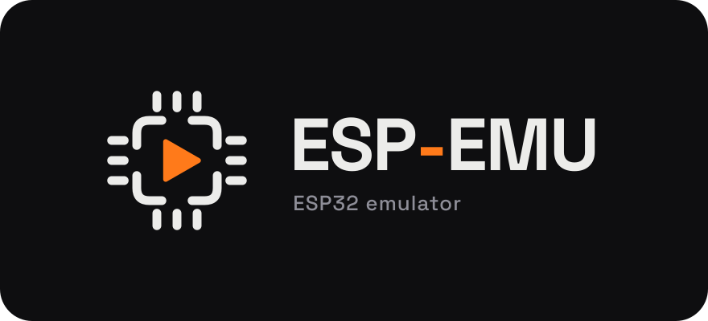

<p align="center">
  
</p>

<h1 align="center">Emulator for ESP32 Series SoCs</h1>

A Rust-based emulator that runs ESP32-C3, ESP32-C5, ESP32-C6, ESP32-H2, ESP32-P4, ESP32-S31 (RISC-V) and ESP32-S3 (Xtensa LX7) firmware binaries — CPU, memory, WiFi, BLE, Thread, Ethernet, crypto, and more. This repo distributes the installer, prebuilt release binaries, user-facing docs, and helper tools.

## Install

One-liner (Linux x86_64 / arm64, macOS Apple Silicon):

```sh
curl -fsSL https://raw.githubusercontent.com/espressif/esp-emulator/main/install.sh | sh
```

This downloads the latest binary to `$HOME/.local/bin/esp-emu`. If `~/.local/bin` is not on your `PATH`, the installer prints the `export PATH=...` line to add.

Pin a specific version:

```sh
curl -fsSL https://raw.githubusercontent.com/espressif/esp-emulator/main/install.sh | sh -s -- --version 0.45.0
```

Other options: `--check` (print latest, no install), `--bin-dir DIR`, `--force`, `--quiet`. Full help:

```sh
curl -fsSL https://raw.githubusercontent.com/espressif/esp-emulator/main/install.sh | sh -s -- --help
```

### Updating

After install:

```sh
esp-emu update           # refresh in place
esp-emu update --check   # only print latest version
esp-emu --version        # print currently installed version
```

`esp-emu update` re-runs the installer against the directory holding the running binary, so it updates wherever you first installed it.

### Manual install (without install.sh)

```sh
# Download the asset for your platform from
# https://github.com/espressif/esp-emulator/releases/latest
tar -xzf esp-emu-<version>-<platform>.tar.gz
cp esp-emu-<version>-<platform>/esp-emu ~/.local/bin/
~/.local/bin/esp-emu --help
```

## Try it in your browser

The browser build is published to GitHub Pages on every release: **<https://espressif.github.io/esp-emulator/>**. Pick a chip, drop a merged flash image (`.bin`) on the page and press Run. The emulator runs entirely in your tab, the firmware never leaves your machine, and a live dashboard shows the console, instruction rate, cores, GPIO pads, registers and memory. For networking, the page's **Network** panel connects to `esp-emu-relay`, a small relay that runs on your machine (Linux, macOS or Windows); install it with `curl -fsSL https://raw.githubusercontent.com/espressif/esp-emulator/main/install.sh | sh -s -- --relay`, or on Windows `irm https://raw.githubusercontent.com/espressif/esp-emulator/main/install-relay.ps1 | iex`, and see [`BROWSER.md`](docs/guides/BROWSER.md).

## Quick Start

### Prerequisites

- A merged flash binary built with ESP-IDF (see [Building Firmware](#building-firmware-images))

Default ROM ELFs (C3 rev3, C5 rev100, C6 rev0, H2 rev0, P4 rev3, S3 rev0) are embedded in the binary, so `--rom` is optional for the common case. Pass `--rom <path>` only to override with a different silicon revision or a custom ROM (e.g. from `~/.espressif/tools/esp-rom-elfs/`).

### Running (quick ESP-IDF example)

```sh
cd esp-idf
cd examples/protocols/https_request
idf.py set-target esp32c3
idf.py merge-bin
esp-emu --chip esp32c3 --firmware build/merged-binary.bin
```

### Building firmware images

The emulator runs merged flash binaries built with ESP-IDF. Requires ESP-IDF environment (`source export.sh`).

```sh
cd your-esp-idf-project
idf.py set-target esp32c3    # or esp32c5, esp32c6, esp32h2, esp32p4, esp32s3
idf.py build
idf.py merge-bin -o build/merged_flash.bin
```

### Common options

| Flag | Default | Description |
|------|---------|-------------|
| `--chip <CHIP>` | (required) | Target chip: `esp32c3`, `esp32c5`, `esp32c6`, `esp32h2`, `esp32p4`, `esp32s3`, or `esp32s31` |
| `--firmware <PATH>` | (required) | Path to merged flash binary |
| `--elf <PATH>...` | — | Application ELF(s): symbolised backtraces, panic intercepts, BLE / Thread interception |
| `--timeout <DURATION>` | — | Exit after duration (e.g. `5s`, `500ms`) |
| `--exit-on <STRING>` | — | Exit with code 0 when UART output contains this string |
| `--inject <DATA>` | — | Payload to inject into UART RX (supports `\n` escape). Repeatable. |
| `--inject-on <STRING>` | — | Trigger string in UART output that causes injection (paired with `--inject`). Repeatable. |
| `--net <BACKEND>` | `tap0` if present on Linux, else `user` | Network backend: `user` (no setup, any OS), `user,hostfwd=tcp::H-:G`, `tap,ifname=tap0` (Linux), `vmnet` (macOS) |
| `--wifi-ssid <SSID>` | `myssid` | WiFi soft AP SSID broadcast to firmware |
| `--wifi-password <PASS>` | `mypassword` | Passphrase for WPA2-PSK and WPA3-SAE. Empty string for open mode |
| `--ble-hci <BACKEND>` | — | BLE HCI backend: `tcp:host:port` for Bumble, `hci0` for a Linux adapter |
| `--uart-tcp <HOST:PORT>` | — | Bridge UART0 to a TCP server so esptool connects via `socket://` |
| `--gdb <PORT>` | — | Serve a GDB remote stub on this port (QEMU's `-s`); `--gdb-halt` waits for the client |
| `--trace <FILE>` | — | Per-task Chrome Trace Event trace for Perfetto; requires `--elf` |

Every flag, with the settings behind flash size, PSRAM size, I2C devices and chip revision, is in [`docs/guides/CLI.md`](docs/guides/CLI.md).

## Features

- **CPU**: RV32IMC on C3; full RV32IMAC on C5/C6/H2; RV32IMAFC (with single-precision FP via Berkeley SoftFloat) on P4; Xtensa LX7 (dual-core, windowed registers, zero-overhead loops, MAC16, FPU) on S3. Multi-hart scheduler supports P4's dual HP cores. RV32 PMP and Espressif PMA enforced via a fused two-level page table — catches the same access violations as silicon (IDF panic memprot tests, TEE REE-vs-TEE isolation, IRAM/IROM write protection). P4 and S31 run the whole PIE SIMD instruction set that ESP-SR, esp-dl and esp-nn use, checked bit for bit against silicon.
- **Access permission control**: the APM and TEE permission controllers (C5, C6, H2, S31), P4's PMS and the `SENSITIVE` PMS monitors on C3 and S3 are enforced for the CPU and DMA, so ESP-TEE, IDF's memprot app and other isolation firmware see the same faults and violation reports as silicon
- **WiFi**: Soft AP with WPA2-PSK, WPA3-SAE (PMF, H2E, transition mode) and WPA2/WPA3-Enterprise (802.1X relayed to a RADIUS server), 802.11 management frames, DHCP server, and TAP networking for real connectivity
- **Ethernet**: OpenCores Ethernet MAC (OpenETH) for QEMU-compatible `CONFIG_ETH_USE_OPENETH` firmware, plus Synopsys DesignWare GMAC for ESP32-P4's built-in EMAC
- **Networking backends**: user-mode (zero-setup, QEMU-style NAT via smoltcp — DHCP, DNS forwarder, mDNS relay with optional record-rewriting NAT for Matter/HomeKit-style service discovery, IPv6 SLAAC, `hostfwd`, restrict mode, ICMP echo), TAP bridge (Linux), vmnet (macOS)
- **BLE**: NimBLE host stack on every BLE chip, plus Bluedroid on ESP32-S31, with HCI forwarding to Bumble (virtual controller) or physical Linux HCI adapters
- **Thread / 802.15.4**: OpenThread `ot_cli` and `ot_br` on ESP32-C6 and ESP32-H2. Single-node forms a partition out of the box; two emulator instances form one Thread mesh (Leader + Child, or Border Router + end device) over a localhost UDP bridge
- **Crypto**: AES (ECB/CBC/OFB/CTR/CFB), SHA (1/224/256), RSA, ECC, HMAC-SHA256, Digital Signature, XTS-AES flash encryption, ECDSA (P-256/P-384 on P4 and C5; P-256 on H2), Key Manager + HUK Generator (P4, C5) — drives flash / HMAC / DS / ECDSA key sourcing for `CONFIG_SECURE_FLASH_ENCRYPTION_KEY_SOURCE_KEY_MGR`
- **Peripherals**: UART, USB Serial JTAG, USB-OTG on S3 (FS), P4 (HS + FS) and S31 (HS) (DWC2 device mode, enumerated by a built-in virtual host; a TinyUSB CDC-ACM port works as the console), GPIO, system timer, timer groups, interrupt controllers (PLIC for C3/C6/H2, CLIC for C5/P4), eFuse, SPI flash, GDMA, GP-SPI, RMT, LEDC, PCNT, MCPWM, I2C (with a built-in EEPROM slave), ADC (C3/C5/C6/H2), and the TIMG/RTC watchdogs
- **LP core and sleep (ESP32-C6)**: IDF `ulp_lp_core` firmware runs on the emulated low-power RISC-V core next to the HP core — started through the PMU or its LP timer, HP↔LP software interrupts, shared LP RAM, `lp_core_printf` over the LP UART on the console. The HP core's deep sleep and light sleep work with the RTC timer and the LP core as wake sources, and the LP core runs on while the HP core sleeps. LP IO/I2C and GPIO/UART wake-ups are not modelled yet
- **esptool / espefuse over `socket://`**: a `--uart-tcp HOST:PORT` bridge plus `--strap-mode 0x02` (UART download) lets esptool, espefuse, and `idf.py flash` drive the running emulator over TCP, matching the QEMU-Espressif workflow. See [esptool / espefuse](docs/guides/FLASHING.md).
- **Chips**: ESP32-C3, ESP32-C5, ESP32-C6, ESP32-H2, ESP32-P4, and ESP32-S3 (dual-core Xtensa; boots the real mask ROM through the IDF bootloader to app_main; 2.4 GHz WiFi station and BLE both work against the built-in controllers; external PSRAM works in both quad and octal mode, `CONFIG_SPIRAM=y`) with per-chip memory maps and interrupt controllers. C5 is a hybrid: a C6-shaped peripheral map driven by a P4-style CLIC on a single core (2.4 GHz WiFi and BLE both work; 5 GHz and 802.15.4 are not modelled). (ESP32-S31 is in early bring-up)
- **Debugging**: `--gdb PORT` serves a GDB remote stub (QEMU `-s -S` equivalent) for `riscv32-esp-elf-gdb` / `xtensa-esp32s3-elf-gdb`; `--trace FILE` records a per-task timeline for Perfetto with no guest instrumentation. See [Execution Tracing and Profiling](docs/guides/HOST-INTERFACES.md#execution-tracing-and-profiling).
- **Virtual parts**: add virtual components to the emulated chip, such as a push button on a GPIO, an SHT31 sensor on I2C or a TMP123 sensor on SPI. They run in the browser build or inside the emulator itself (`--cosim-board`), and the firmware drives them with its stock drivers. [docs/guides/PARTS.md](docs/guides/PARTS.md) runs the examples and walks through writing your own; [`examples/parts/pushbutton`](examples/parts/pushbutton) is a complete part to copy, [`examples/parts/sht31`](examples/parts/sht31) an I2C one and [`examples/parts/tmp123`](examples/parts/tmp123) an SPI one
- **WASM**: Browser-based emulation via WebAssembly with JavaScript API
- **ROM stubs**: Intercepts key ROM functions (printf, UART, delay, WiFi TX) instead of emulating full ROM

## Guides

User guides live at [`docs/guides/`](docs/guides/) and track the latest release:

- [`CLI.md`](docs/guides/CLI.md) — every flag; flash size, PSRAM size, I2C devices, chip revision via eFuse
- [`NETWORKING.md`](docs/guides/NETWORKING.md) — WiFi soft AP (WPA2 / WPA3 / Enterprise), OpenETH and P4 Ethernet, user-mode NAT, TAP and vmnet
- [`HOST-INTERFACES.md`](docs/guides/HOST-INTERFACES.md) — UART injection, UART1 TCP bridge, host control channel, execution tracing
- [`FLASHING.md`](docs/guides/FLASHING.md) — esptool / espefuse / `idf.py flash` over `socket://`
- [`BLE.md`](docs/guides/BLE.md) — NimBLE and Bluedroid against Bumble or a Linux HCI adapter
- [`THREAD.md`](docs/guides/THREAD.md) — OpenThread `ot_cli` / `ot_br` on C6 and H2, two-node meshes over `--thread-sim`
- [`MATTER.md`](docs/guides/MATTER.md) — Matter commissioning and control with chip-tool
- [`HOSTED.md`](docs/guides/HOSTED.md) — ESP-Hosted P4 ↔ C6 SDIO setup
- [`RAINMAKER.md`](docs/guides/RAINMAKER.md) — RainMaker provisioning flow
- [`BROWSER.md`](docs/guides/BROWSER.md) — running the WASM build in a browser (hosted at <https://espressif.github.io/esp-emulator/>)
- [`PARTS.md`](docs/guides/PARTS.md) — virtual parts: run firmware next to a virtual button or sensor, in the browser or the command-line emulator, and write a part of your own

## Tests

`test_apps/` holds the ESP-IDF projects the emulator is tested against.
`test_apps/run_smoke.sh` builds the smoke app for every chip (docker
`espressif/idf:latest` by default, or a sourced `IDF_PATH`) and runs it in
the `esp-emu` on your `PATH`; it passes when the app's `RESULT_SUMMARY:`
reports no failures. The same script runs on every published release against
ESP-IDF master (`.github/workflows/release-smoke.yml`).

```bash
./install.sh
test_apps/run_smoke.sh --chips esp32c3,esp32c6
```

## Releases

Binary tarballs (single-file artifacts containing only the `esp-emu` executable) are published as [GitHub Releases](https://github.com/espressif/esp-emulator/releases). Each release ships these assets:

- `esp-emu-<version>-x86_64-unknown-linux-gnu.tar.gz` — Linux x86_64 native
- `esp-emu-<version>-aarch64-unknown-linux-gnu.tar.gz` — Linux arm64 native
- `esp-emu-<version>-aarch64-apple-darwin.tar.gz` — macOS Apple Silicon native
- `esp-emu-<version>-wasm.tar.gz` — browser WebAssembly bundle
- `esp-emu-<version>-examples.tar.gz` — the examples kit: the button, sensor and thermometer boards, each with its part and ESP32-C3 firmware ready to run ([`PARTS.md`](docs/guides/PARTS.md))
- `SHA256SUMS` — sha256 for each tarball; verified automatically by `install.sh`

Per-version release notes are the body of each [GitHub release](https://github.com/espressif/esp-emulator/releases).

`esp-emu-relay`, the browser build's network relay, has its own release, `relay-v<version>`, with `esp-emu-relay-<version>-<target>.tar.gz` for Linux (x86_64, arm64) and macOS (Intel, Apple Silicon) and a `.zip` for Windows x86_64. Any relay of the same major version works with a page; the source is in [`esp-emu-relay/`](esp-emu-relay/).

## Helper tools

Companion scripts live at [`tools/`](tools/):

- `setup-tap.sh` — create the `tap0` device for TAP networking on Linux
- `bumble_test.py` — virtual BLE controller (Google Bumble) over TCP for HCI testing
- `bumble_classic_peer.py` — virtual controller plus a Classic BT peer that drives ESP32-S31 Bluedroid examples (A2DP sink, SPP, L2CAP, HID, HFP) over BR/EDR
- `ws-net-proxy.py` — WebSocket↔raw-Ethernet bridge for the browser build
- `vhci_bridge.py` — Linux VHCI HCI bridge
- `make-efuse.py` — build an `--efuse` image that reports a given chip revision (`--chip esp32c3 --chip-rev 1.1`)
- `trace-view.py` — serve CPU-per-task and hot-function tables from a `--trace` file
