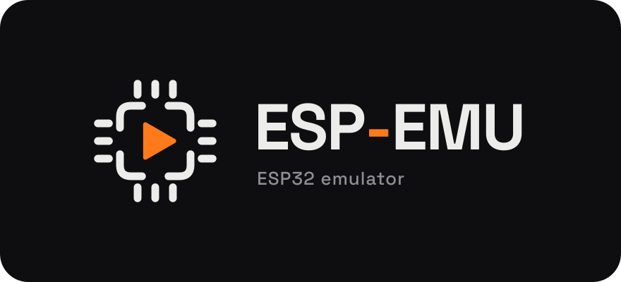
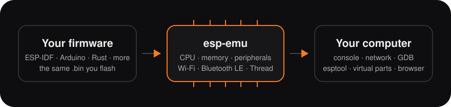

<p align="center">
  
</p>

<h1 align="center">Emulator for ESP32 Series SoCs</h1>

<p align="center">
  Run ESP32 firmware on your computer or in a browser tab. No board needed.
</p>

<p align="center">
  <a href="https://github.com/espressif/esp-emulator/releases/latest"></a>
  <a href="https://espressif.github.io/esp-emulator/"></a>
  <a href="LICENSE"></a>
</p>

<p align="center">
  
</p>

esp-emu runs the same firmware image you would flash to a board. It boots the chip's real ROM and bootloader, then your application, and gives it a console, a Wi-Fi network, Bluetooth and the peripherals it expects.

esp-emu emulates the chip, not a software framework. Firmware built with ESP-IDF, Arduino, Rust `esp-hal` or any other framework runs unchanged, as long as the peripherals it uses are emulated. ESP-IDF firmware is tested the most.

This repository holds the installer, the guides, helper tools, example parts and test apps. Prebuilt binaries are on the [releases page](https://github.com/espressif/esp-emulator/releases).

## Install

On Linux (x86_64, arm64) and macOS (Apple Silicon):

```sh
curl -fsSL https://raw.githubusercontent.com/espressif/esp-emulator/main/install.sh | sh
```

Then run a merged flash image:

```sh
idf.py set-target esp32c3 && idf.py build && idf.py merge-bin
esp-emu --chip esp32c3 --firmware build/merged-binary.bin
```

To update later, run `esp-emu update`. For other ways to install and for the most common options, see [Getting Started](docs/guides/GETTING-STARTED.md).

## Try it in your browser

**<https://espressif.github.io/esp-emulator/>**

Pick a chip, drop a firmware image on the page and press Run. The emulator runs inside your tab and the firmware never leaves your computer. To give the firmware network access in the browser, install the small relay described in the [browser guide](docs/guides/BROWSER.md).

## Supported chips

<!-- chip-list:begin -->
| Chip | CPU | Emulated radios | Supported |
|------|-----|-----------------|:---------:|
| ESP32 | Xtensa LX6 ×2 | Wi-Fi · Bluetooth LE | ✅ |
| ESP32-C3 | RV32IMC | Wi-Fi · Bluetooth LE | ✅ |
| ESP32-C5 | RV32IMAC | Wi-Fi · Bluetooth LE | ✅ |
| ESP32-C6 | RV32IMAC + LP core | Wi-Fi · Bluetooth LE · Thread | ✅ |
| ESP32-H2 | RV32IMAC | Bluetooth LE · Thread | ✅ |
| ESP32-P4 | RV32IMAFC ×2 | — | ✅ |
| ESP32-S3 | Xtensa LX7 ×2 | Wi-Fi · Bluetooth LE | ✅ |
| ESP32-S31 | RV32IMAFC ×2 | Wi-Fi · Bluetooth LE | ✅ |
<!-- chip-list:end -->

Every chip boots its real ROM and bootloader. ESP32-P4 has no radio and gets Wi-Fi through [ESP-Hosted](docs/guides/HOSTED.md). The **[support matrix](docs/guides/FEATURES.md#support-matrix)** shows which peripherals work on each chip and which are not emulated yet.

## Documentation

| Guide | What it covers |
|-------|----------------|
| [Getting Started](docs/guides/GETTING-STARTED.md) | install, update, build an image, run it, common options |
| [Features](docs/guides/FEATURES.md) | what works on each chip, in detail |
| [Command line](docs/guides/CLI.md) | every flag; flash size, PSRAM, SD card, chip revision |
| [Networking](docs/guides/NETWORKING.md) | Wi-Fi, Ethernet, and how the firmware connects to your network |
| [Bluetooth LE](docs/guides/BLE.md) | virtual controllers and Linux adapters |
| [Thread](docs/guides/THREAD.md) | OpenThread on ESP32-C6 and H2 |
| [Matter](docs/guides/MATTER.md) · [RainMaker](docs/guides/RAINMAKER.md) · [ESP-Hosted](docs/guides/HOSTED.md) | step-by-step setups |
| [Flashing](docs/guides/FLASHING.md) | esptool, espefuse and `idf.py flash` over a socket |
| [Host interfaces](docs/guides/HOST-INTERFACES.md) | console input, UART bridges, host control, tracing, co-simulation |
| [Virtual parts](docs/guides/PARTS.md) | buttons, sensors, displays and cameras connected to the chip, and how to write your own |
| [Browser](docs/guides/BROWSER.md) | the WebAssembly build and its JavaScript API |

## Help

Found a bug, or need a peripheral that is not emulated yet? [Open an issue](https://github.com/espressif/esp-emulator/issues). The [release notes](https://github.com/espressif/esp-emulator/releases) list what changed in each version.
